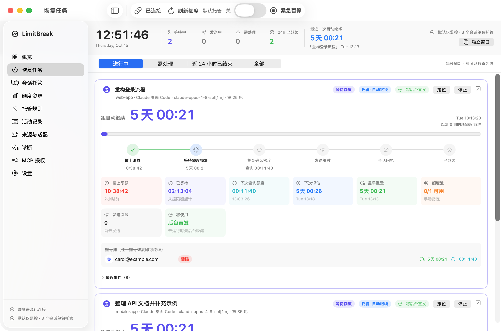
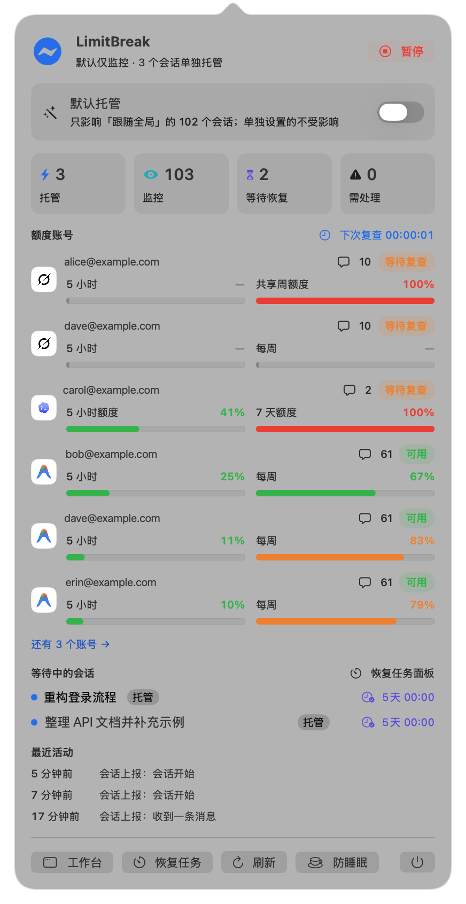
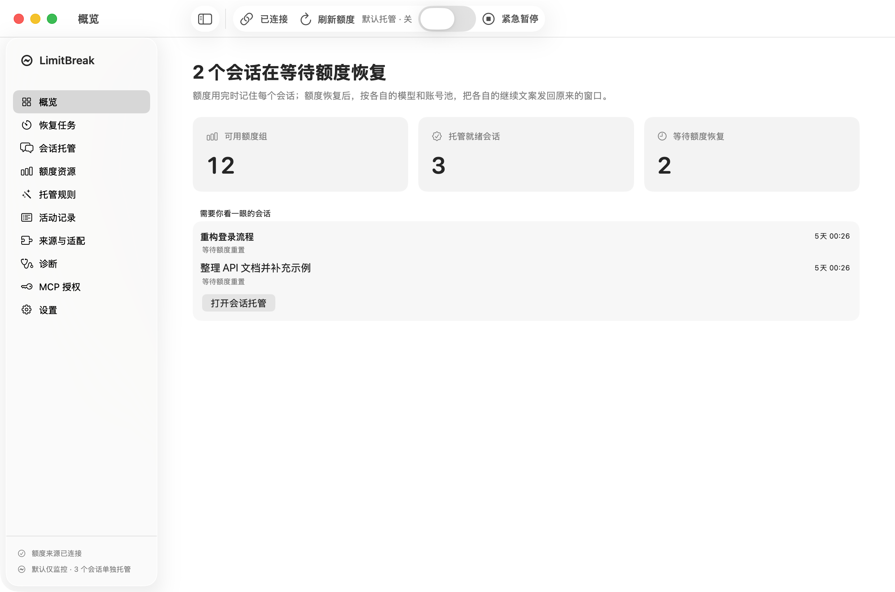
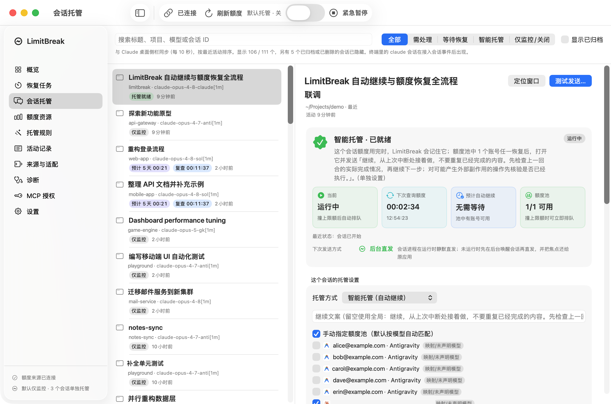
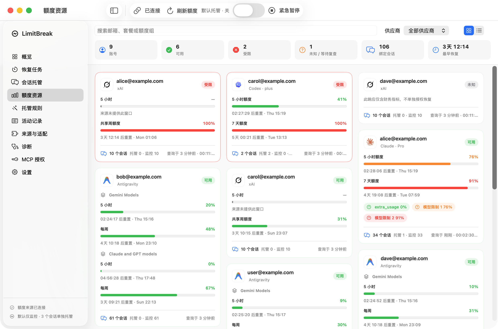
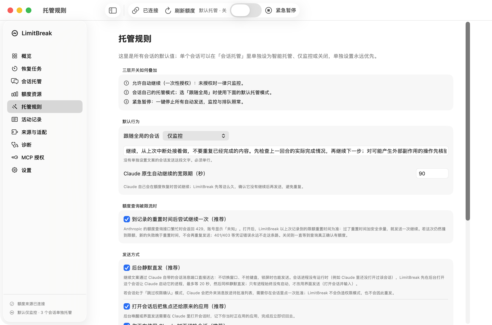
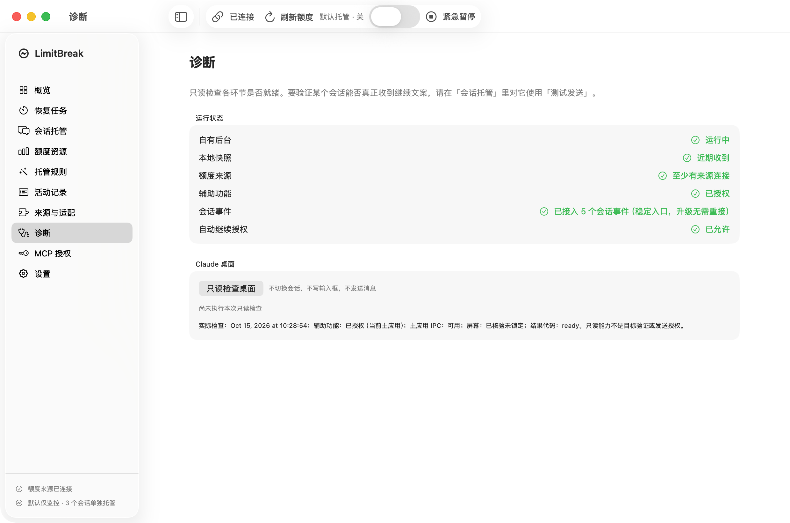

<div align="center">

# LimitBreak（额度守护）

**撞上额度上限，放心走开。额度真正恢复的那一刻，LimitBreak 替你在原来的 Claude Code 会话里说一句「继续」。**

原生 macOS 菜单栏应用 + 本机后台。通过 [CLIProxyAPI](https://github.com/router-for-me/CLIProxyAPI) 观测真实额度，等到重置，再把继续文案发回**同一个**会话——Claude 桌面（Code 标签）或终端 `claude`。

[](https://github.com/GentlemanHu/limitbreak/actions/workflows/ci.yml)
[](https://github.com/GentlemanHu/limitbreak/releases)


[](LICENSE)

[English](README.md) · 简体中文

</div>

<p align="center">
  
  &nbsp;
  
</p>

---

## 为什么需要它

长时间运行的 Claude Code 任务会停在 5 小时或每周限额上。Claude 自带的自动继续只在它自己看到重置时触发，也不知道你 CLIProxyAPI 池里另一个账号其实空着。LimitBreak 补上这一段：

- **看真实额度，不靠猜**：经 CLIProxyAPI 读取每个账号的 5 小时、每周和模型族窗口。读不到就显示「未知」，绝不显示成 0%。
- **同一个会话、同一个模型**：只发送继续文案，不改会话的模型、账号或权限模式。
- **后台静默直发**：会话进程在运行时，消息走 Claude Code 自带的跨会话消息端口——不切窗口、不抢键盘，锁屏也能发。进程已退出时，先在后台打开会话让 Claude 拉起进程，再同样经消息端口静默送达。只有进程始终起不来，才在 Claude 窗口里输入——而且会等你不在用 Claude 时才做，做完把焦点还给你原来的应用。处于「跳过权限确认」模式（或尚未上报权限模式）的会话不走直发，直接用界面发送：Claude Code 会扣下不带发送方权限模式的跨会话消息等待批准，而本程序不伪造权限模式。
- **发送方式看得见**：每次恢复都记录实际通道（后台直发、唤醒后直发或界面发送）以及回落原因。
- **默认安全**：一次性的自动继续授权、紧急暂停、每会话每小时上限、熔断、带租约的公平队列，结果不确定时**绝不自动重发**。
- **到处都有时钟**：每个会话四块实时卡片——当前状态、下次查询额度、预计自动继续、额度池可用数。

## 功能一览

| | |
|---|---|
| 托管模式 | 每个会话可选：跟随全局 / 智能托管 / 仅监控 / 关闭；另有全局默认与紧急暂停。 |
| 额度池 | 按会话模型自动匹配（映射 → 精确 → 前缀 → 供应商），也可手动指定账号——适合 CLIProxyAPI 把某个模型名映射到其他供应商的情况。 |
| 额度来源 | Claude（OAuth 用量）、Codex、Antigravity、xAI，以及 CLIProxyAPI 额度插件提供的任何供应商；也可在配置里接自定义 HTTP 来源。 |
| 重置信号 | 内置 [Codex Resets](https://codex-resets.com) 信号源，另有带签名的 `POST /api/signals` Webhook。收到信号后立刻重查对应供应商的账号（3 分钟、10 分钟后各再查一次）；信号本身永远不算额度已恢复的证据。 |
| 查询被限流 | 用量接口本身返回 HTTP 429 时，等到记录的重置时间 + 安全余量后**尝试一次**（策略 `reset_fallback`，默认开启）。 |
| 执行器 | Claude 桌面（直发端口；后台唤醒后直发；最后才用深链接 + 辅助功能；跳过权限确认或未上报权限模式的会话只用这一条）、终端 `claude`（直发端口、tmux，或后台 `claude -p --resume`），以及通过配置命令接入的其他客户端（`clients[]`）。 |
| 界面 | 原生 SwiftUI 工作台：真实供应商图标的瀑布流额度卡片、与 Claude 桌面侧栏同步的会话列表、活动记录、诊断。工作台打开时显示程序坞图标。 |
| 集成 | 本机带令牌的 HTTP API、SSE 事件、按范围授权的 MCP 服务、`orchestrator event` / `orchestrator signal` 命令行。 |

## 截图

以下截图中的账号与会话标题均已替换为占位内容。

| | |
|---|---|
|  **概览**——现在需要你看一眼的事。 |  **会话托管**——与 Claude 桌面侧栏同步，可单独设置托管方式、额度池和继续文案。 |
|  **额度资源**——每个账号的窗口、重置时间和绑定会话。 |  **托管规则**——全局默认、发送方式与安全开关。 |
|  **诊断**——只读的就绪检查。 | |

页首两张图是**恢复任务**（从撞上限额到确认继续的时间线）和**菜单栏弹窗**。

## 运行要求

- macOS 14 及以上（Apple Silicon 或 Intel）。
- 本机运行 [CLIProxyAPI](https://github.com/router-for-me/CLIProxyAPI) 并开启管理接口。LimitBreak 通过它读取额度：
  - `GET /v0/management/auth-files` 列出账号；
  - `POST /v0/management/api-call` 以对应账号调用各供应商的用量接口（令牌由 CLIProxyAPI 自己替换，凭据不会进入 LimitBreak）；
  - 若你的 CLIProxyAPI 版本提供，还会用 `POST /v0/management/quota/fetch` 和额度插件。
- Claude Code（桌面 Code 标签或终端 `claude`）。

## 安装

**一行命令**（下载最新版本、校验 SHA-256、备份旧版本、去除隔离属性）：

```bash
curl -fsSL https://raw.githubusercontent.com/GentlemanHu/limitbreak/main/scripts/install.sh | LIMITBREAK_REPO=GentlemanHu/limitbreak bash
```

**手动安装**：从 [Releases](https://github.com/GentlemanHu/limitbreak/releases) 下载 `LimitBreak-<版本>-universal.zip`，用 `shasum -a 256 -c SHA256SUMS` 校验，解压后把 `LimitBreak.app` 拖进「应用程序」。

### 提示「已损坏，无法打开」怎么办

应用并没有损坏。没有 Developer ID 签名和苹果公证的应用，经浏览器下载后带有 `com.apple.quarantine` 隔离属性，Gatekeeper 就会这样提示，Apple Silicon 机器上尤其常见。执行一次即可：

```bash
xattr -dr com.apple.quarantine /Applications/LimitBreak.app
```

配置了签名密钥的 Release（见下文「发布流程」）会经过公证并装订票据，可以直接打开。

## 首次使用

1. 启动 CLIProxyAPI（默认 `127.0.0.1:8317`），准备好管理密钥。
2. 打开 LimitBreak，「概览」里的准备清单依次是：
   - 连接 CLIProxyAPI；
   - 授予辅助功能权限（只有回退到窗口输入时需要）；
   - 接入 Claude Code Hooks（先展示差异，确认后才写入）——LimitBreak 靠它得知会话撞上了限额；
   - 允许自动继续。
3. 在「会话托管」里选中会话，设为「智能托管」。状态卡会告诉你它会做什么、预计什么时候做。

私有数据保存在 `~/Library/Application Support/Quota Session Guard/`（保留旧名称，升级后权限和数据都不丢）。

## 它如何决定发送

```
StopFailure(限额) ──► 会话进入 COOLDOWN ──► 按离重置的远近分级查询额度
                                              │
         撞限额之后的新鲜「可用」读数 ◄────────┤────► 查询被限流(429) 且记录的
                                              │      重置 + 安全余量已过 → 尝试一次
                                              ▼
                       原生宽限期（让 Claude 自己的自动继续优先）
                                              ▼
              公平队列 + 租约 ──► 后台直发端口 ─► 后台唤醒会话后直发
                                                   └──► 深链接 + 辅助功能（进程始终未启动）
                                              ▼
              VERIFYING，直到会话自己的 Hook 确认（UserPromptSubmit）
```

送达结果不确定时，如实标记为「不确定」，不会自动重发。

## 从源码构建

需要 macOS 14+、Xcode 命令行工具（Swift 5.9+）、Go 1.24+。

```bash
bash scripts/verify.sh
```

```bash
QSO_ALLOW_ADHOC=1 bash scripts/build-app.sh
```

常用变量：`QSO_SIGN_IDENTITY`（钥匙串中已有的签名身份）、`QSO_UNIVERSAL=1`（arm64 + x86_64）、`QSO_SIGN_TIMESTAMP=1`（公证需要）、`QSO_APP_OUTPUT`、`QSO_CREATE_ZIP=1`。构建从不覆盖已有产物。

## 发布流程

- `ci.yml`：每次 push 和 PR 运行 `go vet`、`go test -race`、Python 测试、Swift 编译（警告即错误）、原生契约测试，并产出临时签名的应用包。
- `release.yml`：推送 `v*` 标签或手动触发。构建 universal 应用；仓库配置了以下 secrets 时用 Developer ID 签名并公证：`MACOS_CERTIFICATE_P12`（base64）、`MACOS_CERTIFICATE_PASSWORD`、`MACOS_SIGN_IDENTITY`、`APPLE_ID`、`APPLE_TEAM_ID`、`APPLE_APP_PASSWORD`。未配置时发布临时签名版本，并在发布说明里写明。

## 扩展

大多数扩展不用写代码。**[docs/EXTENDING.md](docs/EXTENDING.md)**（英文）逐一说明各接口契约并附示例：

| 扩展 | 方式 | 需要重新构建 |
|---|---|---|
| 额度来源 | `readonly-http` 来源，返回 `normalized-v1` JSON | 否 |
| 重置信号 | `POST /api/signals`（Bearer 令牌或 HMAC 签名），或用 Go 写轮询信号源（`internal/signals`） | Webhook 不需要 |
| 其他客户端（Codex CLI、你自己的 Agent 等） | `config.json` 中的 `clients[]` + `orchestrator event --client …` | 否 |
| 桌面执行器 | 用 Go 实现 `executor.Backend` | 是 |

调度、队列、安全门控和界面都与供应商无关。经过实测的客户端是 Claude 桌面和终端 `claude`。通用客户端通道有单元测试覆盖，但**尚未**在 Codex CLI、WorkBuddy 或 DeepSeek 客户端上实际跑过；EXTENDING.md 里的包装脚本只是起点，不是受支持的集成。

## 隐私与安全

- 只读取 `~/.claude/sessions/*.json` 中的非机密字段（PID、启动时间、会话 ID、端口路径、状态、协议版本）。从不读取 `.key` 令牌文件、对话记录或对话内容。
- 从不声明或伪造权限模式；处于「跳过权限确认」的会话可能需要你在会话里批准这条外来消息。
- 本机 API 只监听回环地址，需要 Bearer 令牌，并拒绝任何带 `Origin` 头的请求。只有 `POST /api/signals` 另外接受 HMAC 签名，而且仅在你创建了 Webhook 密钥之后。
- Codex Resets 信号源不发送任何账号数据：只是对公开状态接口的普通 GET，且仅在存在 Codex 账号时才轮询。把 `signals.feeds` 设为 `[]` 即可关闭。

报告漏洞请看 [SECURITY.md](SECURITY.md)。

## 常见问题

**手动指定额度账号后，还会保留我在 Claude 里选的模型吗？** 会。额度池只决定「等谁的额度恢复」，LimitBreak 只发送继续文案，别的都不碰。

**为什么用 Go + Swift？** 后台需要常驻、在应用重启后继续工作、独占 SQLite 状态，用 Go 写得小且好测；界面、辅助功能、程序坞和菜单栏都是 macOS 原生 API，所以用 Swift。

**和 Anthropic 有关系吗？** 没有。LimitBreak 是独立的开源工具。Claude 是 Anthropic 的商标；供应商图标仅用于标识供应商（见 `tray/Resources/ProviderIcons/NOTICE.md`）。

## 参与贡献

见 [CONTRIBUTING.md](CONTRIBUTING.md) 与 [CHANGELOG.md](CHANGELOG.md)。

## 致谢

- [CLIProxyAPI](https://github.com/router-for-me/CLIProxyAPI)（MIT，router-for-me）——没有它就没有 LimitBreak。账号与凭据都由它保管，LimitBreak 只通过它的管理接口查询额度。LimitBreak 是独立项目，与 CLIProxyAPI 无隶属关系，欢迎去给它点星支持。
- 供应商图标归各自所有者，仅用于标识供应商，见 [`tray/Resources/ProviderIcons/NOTICE.md`](tray/Resources/ProviderIcons/NOTICE.md)。

## 许可证

[MIT](LICENSE)
